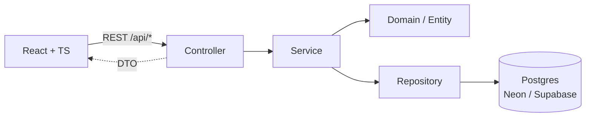
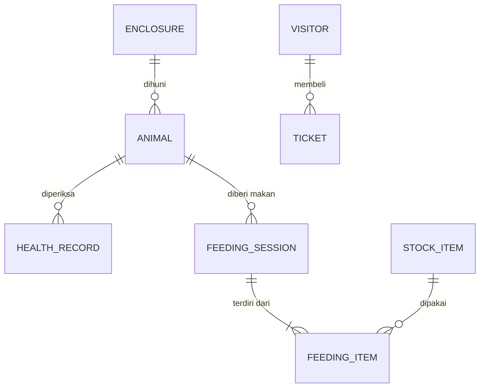
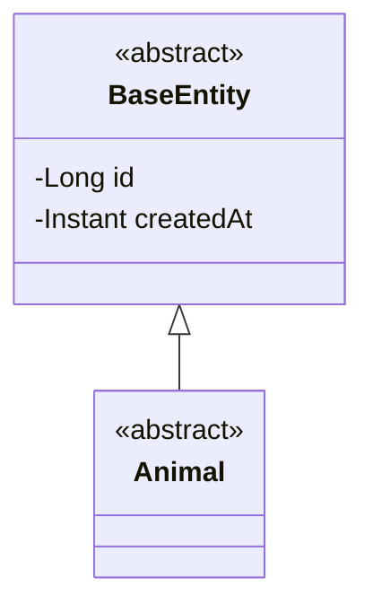

# Arsitektur

## Alur request

## Use case diagram
TODO: gambar use case (aktor: Admin, Petugas kandang, Dokter hewan, Pengunjung) lalu tempel gambarnya di sini.

## ERD
TODO: lengkapi entitas dan relasi. Kerangka awal (ubah sesuai desain kelompok):

## Class diagram
TODO: gambar hierarki kelas (abstract class, interface, inheritance, composition) sesuai kode, lalu tempel di sini.

